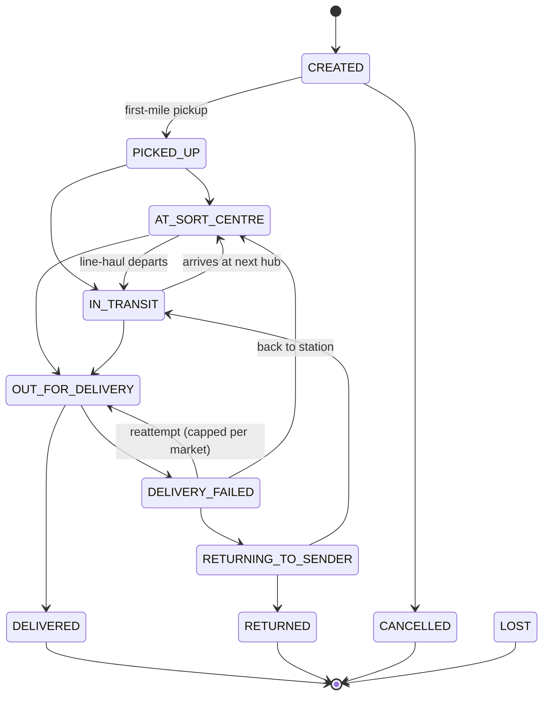

# Canonical parcel state machine

Source of truth in code: `src/tracking/state_machine.py` (`ALLOWED`).

Not drawn, to keep the diagram readable: every non-terminal status can go to **LOST**.

| From | Allowed next statuses |
|---|---|
| CREATED | PICKED_UP, CANCELLED, LOST |
| PICKED_UP | AT_SORT_CENTRE, IN_TRANSIT, LOST |
| AT_SORT_CENTRE | IN_TRANSIT, OUT_FOR_DELIVERY, LOST |
| IN_TRANSIT | AT_SORT_CENTRE, OUT_FOR_DELIVERY, LOST |
| OUT_FOR_DELIVERY | DELIVERED, DELIVERY_FAILED, LOST |
| DELIVERY_FAILED | OUT_FOR_DELIVERY*, AT_SORT_CENTRE, RETURNING_TO_SENDER, LOST |
| RETURNING_TO_SENDER | IN_TRANSIT, RETURNED, LOST |
| DELIVERED, RETURNED, LOST, CANCELLED | none (terminal) |

\* Only while failed attempts are below the market cap (PRD 6.4).

## Event outcomes

| Outcome | Status changes? | Stored? | Buyer sees it? |
|---|---|---|---|
| applied | Yes | Yes | Yes |
| duplicate | No | No (already stored) | — |
| history_only | No | Yes | Yes, in timeline order |
| needs_review | No | Yes, flagged | No, until operations resolve it |
| quarantined | No | Yes, flagged | No |
| rejected | No | No | No |
